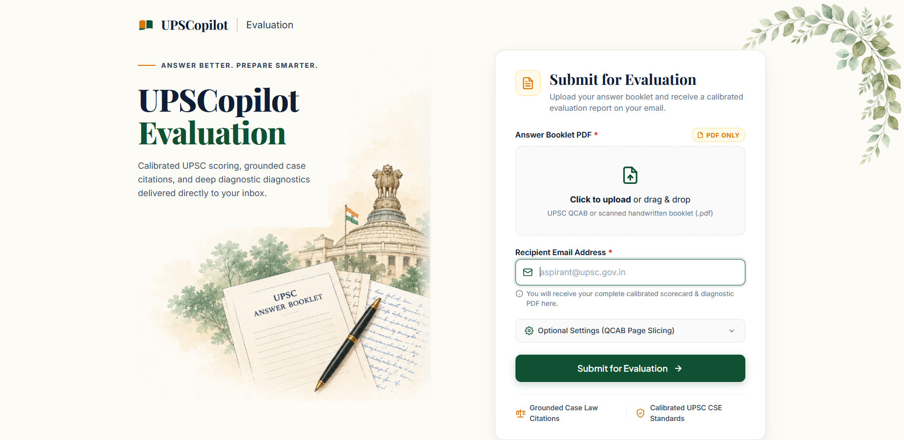

# UPSCopilot (`upsc-evaluator`)

[](https://www.python.org/downloads/)
[](https://github.com/astral-sh/ruff)
[](tests/)
[](template.yaml)
[](src/providers/)
[](https://smith.langchain.com/public/f553aa87-076d-4431-944a-cb8aecad7743/r/01a10363-900f-7be1-976d-17257b4deca1?start_time=2026-10-03T20%3A10%3A19.023878Z)

> **Calibrated, grounded, and anti-sycophantic evaluation engine for UPSC Civil Services Mains handwritten answers.**  
> Powered by dynamic page-by-page multimodal vision OCR, Knowledge Base RAG verification, and continuous logprob G-Eval scoring calibrated to authentic UPSC CSE standards.

<p align="center">
  
</p>

> 📊 **[View Full 6-Pillar Marking Rubrics & Empirical Benchmarks →](RUBRICS_AND_BENCHMARKS.md)**

---

## Why UPSCopilot?

Generic LLM prompts fail when evaluating UPSC Civil Services Mains answer copies:
1. **Severe Grade Inflation**: Standard LLMs award 140–165 / 250 marks (56–66%), whereas real UPSC CSE all-India toppers (AIR 1–50) score **105–118 / 250 marks** (42–47%).
2. **Evaluation Sycophancy**: Models praise fluent English while ignoring missed directives (*Critically Analyze* vs. *Elucidate*), shallow dimensions, and missing citations.
3. **Score Drift**: Re-running standard prompts on the same copy produces arbitrary swings of $\pm 20\%$.
4. **Unverified Citations**: Standard models fail to verify whether cited legal and statutory references actually exist or support the argument.

**UPSCopilot** eliminates these issues through **Knowledge Base RAG grounding**, **Hard Demand Relevance Gates**, and **Probability-Weighted Continuous Logprob Scoring**—achieving near-deterministic stability ($\sigma = 0.82$ marks across 250-mark full-length copies).

👉 See [**`RUBRICS_AND_BENCHMARKS.md`**](RUBRICS_AND_BENCHMARKS.md) for the complete 6-pillar scoring rubric, mathematical calibration formulas, and multi-run consistency benchmarks.

---

## AWS Request Flow & Cloud Architecture

The diagram below illustrates how an evaluation request travels across AWS services from browser upload to scorecard delivery:

```
┌───────────────────────────┐
│     Candidate Browser     │
└─────────────┬─────────────┘
              │
              │ 1. GET /api/v1/jobs/upload-url (Request Presigned S3 URL)
              ▼
┌──────────────────────────────────────────────────────────┐
│  FastAPI Web Server (AWS EC2 / API Gateway + ApiLambda)  │
└──────┬────────────────────────────────────────────┬──────┘
       │                                            │
       │ 2. Direct HTTP PUT (Up to 200 MB PDF)      │ 3. POST /api/v1/jobs/submit-direct
       ▼                                            │    • Creates Job (PENDING) in DynamoDB
┌───────────────────────────┐                       │    • Enqueues Job ID in SQS
│         Amazon S3         │                       ▼
│      (UploadsBucket)      │         ┌───────────────────────────┐
└─────────────┬─────────────┘         │        Amazon SQS         │
              │                       │ (EvaluationQueue + DLQ)   │
              │                       └─────────────┬─────────────┘
              │                                     │
              │ 4. Download PDF                     │ 4. Long-Poll Job Message
              └─────────────────┐   ┌───────────────┘
                                ▼   ▼
              ┌───────────────────────────────────────────┐
              │       EC2 Coordinator Worker Daemon       │
              │        (Concurrency-Gated: Max 2)         │
              │                                           │
              │  a) Dynamic Page-by-Page Vision OCR       │
              │     & Question Boundary Stitching         │
              │  b) Parallel Knowledge Base (RAG)         │
              │     Ground-Truth Prefetch                 │
              └─────────────────────┬─────────────────────┘
                                    │
                                    │ 5. Parallel Fan-Out Invocations (boto3 Lambda Invoke)
                    ┌───────────────┼───────────────┐
                    ▼               ▼               ▼
            ┌───────────────┐ ┌───────────┐ ┌───────────────┐
            │  AWS Lambda   │ │    ...    │ │  AWS Lambda   │
            │  Question 1   │ │  Q2..Q19  │ │  Question 20  │
            ├───────────────┤ └───────────┘ ├───────────────┤
            │ • Call 1: CoT │               │ • Call 1: CoT │
            │ • Call 2:     │               │ • Call 2:     │
            │   G-Eval      │               │   G-Eval      │
            └───────┬───────┘               └───────┬───────┘
                    └───────────────┬───────────────┘
                                    │ 6. Return Question Evaluations
                                    ▼
              ┌───────────────────────────────────────────┐
              │         Finalization & Delivery           │
              │                                           │
              │  • Distills Student Evaluation Report     │
              │  • Renders High-Res PDF Scorecard         │
              │  • Sends Email + PDF Attachment (SMTP)    │
              │  • Updates Amazon DynamoDB (COMPLETED)    │
              │  • Deletes Temporary PDF from Amazon S3   │
              │  • Flushes Hierarchical Trace (LangSmith) │
              └───────────────────────────────────────────┘
```

### Step-by-Step Request Lifecycle
1. **Presigned URL Generation**: The client requests a short-lived S3 upload URL from `GET /api/v1/jobs/upload-url`.
2. **Direct-to-S3 PDF Upload**: The browser streams the scanned answer booklet PDF directly into **Amazon S3 (`UploadsBucket`)**, bypassing API Gateway payload limits.
3. **Asynchronous Job Dispatch**: The client calls `POST /api/v1/jobs/submit-direct`. The API records the initial `PENDING` state (with a 14-day TTL) in **Amazon DynamoDB (`JobStateTable`)**, dispatches the job payload to **Amazon SQS (`EvaluationQueue`)**, and immediately returns `HTTP 202 Accepted`.
4. **OCR & Knowledge Base Prefetch (EC2 Coordinator)**: The long-polling **EC2 Worker Daemon** pulls the SQS message, updates **DynamoDB** to `PROCESSING`, downloads the PDF from **Amazon S3**, runs **Dynamic Page-by-Page Vision OCR** to stitch question boundaries, and prefetches relevant ground-truth context from the **Knowledge Base** in parallel.
5. **Parallel AWS Lambda Fan-Out**: The coordinator fans out concurrent invocations to **AWS Lambda (`SingleQuestionEvalFunction`)** across questions. Each micro-worker executes the 2-call evaluation protocol (Call 1: Diagnostic CoT & Citation Verification; Call 2: Continuous Logprob G-Eval Scoring).
6. **Scorecard Delivery & Cleanup**: Results are aggregated into a high-resolution `UPSC_Evaluation_Scorecard.pdf` (via `PyMuPDF Story`), emailed to the candidate via **SMTP**, marked `COMPLETED` in **Amazon DynamoDB**, purged from **Amazon S3**, and logged as a single nested trace tree in **LangSmith**.

---

## Repository Layout

```
evaluator/
├── pyproject.toml              # Dependencies, pytest config, ruff config
├── template.yaml               # AWS SAM IaC (S3, DynamoDB, SQS, API & SingleQuestionEval Lambdas)
├── Dockerfile                  # Production container image for AWS Lambda
├── RUBRICS_AND_BENCHMARKS.md   # 6-pillar rubrics, calibration math & empirical benchmarks
├── .env.example                # Environment configuration template
│
├── data/                       # Local data & Knowledge Base directory
├── src/                        # Production application package
│   ├── config.py               # Pydantic Settings singleton
│   ├── orchestrator.py         # Local unified evaluation & distillation pipeline
│   ├── orchestrator_ec2.py     # EC2 concurrency-gated coordinator + Lambda fan-out
│   ├── api/                    # FastAPI routes (/upload-url, /submit-direct, /submit, /health)
│   ├── handlers/               # Cloud & daemon entrypoints (ec2_worker, single_question_eval, api)
│   ├── providers/              # Multi-provider LLM & Vision clients (Vertex AI & AWS Bedrock)
│   ├── evaluation/             # 2-call diagnostic engine, G-Eval logprob scorer & prompts
│   ├── parsing/                # Dynamic page-by-page OCR, stitcher, preprocessor & segmenter
│   ├── kb/                     # Knowledge Base loader, retriever & batch prefetcher
│   ├── models/                 # Pydantic schemas (api, evaluation, parsing, kb, enums)
│   ├── services/               # S3 storage, DynamoDB state, SQS queue, PDF & SMTP email adapters
│   ├── static/                 # Single-page responsive web UI (index.html)
│   └── utils/                  # JSON parser, CLI helpers & LangSmith tracing utilities
│
├── scripts/                    # CLI tools (evaluate/, parse/, ingest/, deploy/, dev/)
└── tests/                      # Automated test suite (72 offline tests passing)
```

---

## Getting Started

### 1. Prerequisites
- Python 3.11+
- [`uv`](https://docs.astral.sh/uv/) package manager

### 2. Installation
```bash
git clone https://github.com/Powder-03/UPSCopilot.git
cd evaluator
uv sync
```

### 3. Environment Configuration
Copy `.env.example` to `.env` and configure your credentials:
```env
LLM_PROVIDER=vertex                   # "vertex" or "bedrock"
GEMINI_API_KEY=your_gemini_api_key
GCP_PROJECT_ID=your_gcp_project_id
GCP_LOCATION=us-central1

# Email Delivery (SMTP / Gmail)
EMAIL_PROVIDER=smtp
SMTP_HOST=smtp.gmail.com
SMTP_PORT=587
SMTP_USER=your_email@gmail.com
SMTP_PASSWORD=your_google_app_password

# Optional: AWS Cloud Services (S3, SQS, DynamoDB, Lambda Fan-Out)
AWS_REGION=us-east-1
AWS_ACCESS_KEY_ID=your_aws_key
AWS_SECRET_ACCESS_KEY=your_aws_secret

# Optional: LangSmith Tracing
LANGSMITH_TRACING=true
LANGSMITH_API_KEY=your_langsmith_api_key
LANGSMITH_PROJECT=upsc-evaluator
```

### 4. Run Tests & Linter
```bash
# Run all 72 offline unit & integration tests
uv run pytest -m "not bedrock"

# Run Ruff linter
uv run ruff check .
```

---

## Usage

### Start the Web Application
```bash
uv run uvicorn src.api.app:app --host 0.0.0.0 --port 8000 --reload
```
Navigate to `http://localhost:8000` to upload a scanned UPSC answer booklet PDF and receive a compiled PDF scorecard via email.

### Evaluate a PDF Booklet via CLI
```bash
uv run python scripts/evaluate/evaluate_pdf.py \
  --pdf path/to/answer_booklet.pdf \
  --email aspirant@example.com \
  --workers 4
```

### Deploy AWS Serverless Resources (SAM)
```bash
sam build --use-container
sam deploy --guided
```

---

## License
MIT License. Developed for calibrated, transparent, and grounded UPSC Mains answer evaluation.
